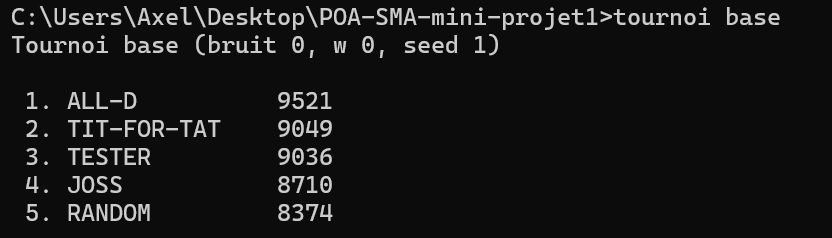

# Journal de bord – Tournoi du dilemme du prisonnier itéré

HAI716I – Projet 2 (partie 1) – travail individuel

## 1. Protocole

- **Langage :** C++ (C++17), compilé avec `make`.
- **Gains :** ceux du cours. C/C = 3/3, C/D = 0/5, D/C = 5/0, D/D = 2/2.
- **200 tours par partie et 5 parties par paire**, comme dans le tournoi d'Axelrod présenté en cours.
- **Qui joue contre qui :** chaque stratégie contre chaque autre, mais pas contre elle-même, parce que le sujet dit « chaque stratégie affronte chaque autre ».
- **Classement :** sur le score total, c'est-à-dire la somme des points contre tous les adversaires.
- **Graine :** 1 par défaut, fixée avec `srand`, et on peut en donner une autre (`./tournoi base 7`). Avec la même graine, je retrouve exactement les mêmes résultats à chaque lancement. Les résultats de ce journal ont été obtenus sur mon PC : `rand()` ne tire pas les mêmes nombres sur tous les systèmes, donc sur un autre ordinateur les scores peuvent être un peu différents.
- **Modifications de l'étape 3 :** le bruit (5 %) et l'horizon inconnu (w = 0,995, donc 200 tours en moyenne). Je les ai choisies parce que ce sont les plus simples à coder : le bruit, c'est une fonction de quelques lignes qui inverse un coup, et l'horizon inconnu change seulement la longueur des parties. En plus, elles sont directement liées au cours : la slide 72 pour le bruit (une erreur entre deux TIT-FOR-TAT) et les slides 61-62 pour l'horizon (la récurrence à rebours et l'ombre du futur).
- **Horizon inconnu :** les longueurs des 5 parties sont tirées une seule fois au début du tournoi, et toutes les paires jouent les mêmes longueurs. Sinon, une stratégie pourrait gagner juste parce qu'elle est tombée sur des parties plus longues.

## 2. Les stratégies

### ALL-D
- **Règle :** joue toujours D.
- **Origine :** c'est la stratégie « rationnelle » donnée par la récurrence à rebours (slide 61).
- **Bien contre :** les stratégies qui ne punissent pas : ALL-C (5000 points, le maximum possible) et RANDOM (environ 3500).
- **Mal contre :** les stratégies qui ripostent, contre lesquelles elle ne gagne que 2 points par tour (environ 2000 sur un match).
- **Pourquoi :** elle ne se fait jamais avoir, mais elle ne profite jamais de la coopération.

### RANDOM
- **Règle :** C ou D à pile ou face.
- **Origine :** le témoin du tournoi d'Axelrod.
- **Bien contre :** ALL-C, qui coopère quoi qu'il arrive.
- **Mal contre :** ALL-D et RANCUNIER, qui la punissent tout le temps (environ 1000 points contre chacun).
- **Pourquoi :** elle ne réagit à rien, donc elle ne sait ni coopérer ni se défendre.

### TIT-FOR-TAT
- **Règle :** C au premier tour, puis recopie le dernier coup de l'adversaire.
- **Origine :** Anatol Rapoport, gagnant du tournoi d'Axelrod en 1980.
- **Bien contre :** les stratégies gentilles (ALL-C, RANCUNIER, MAJORITAIRE), avec qui elle coopère tout le temps (3000 points).
- **Mal contre :** ALL-D, contre qui elle perd le premier tour puis tout le monde trahit, et JOSS, qui déclenche des punitions en écho.
- **Pourquoi :** elle copie l'adversaire, donc elle ne le bat jamais en duel, mais elle profite bien de la coopération.

### TESTER
- **Règle :** D au premier tour ; si l'adversaire a déjà joué D, elle fait comme TIT-FOR-TAT ; sinon elle répète C, C, D.
- **Origine :** stratégie du tournoi d'Axelrod, présentée dans le cours. La slide dit « si l'adversaire riposte » sans dire quand ; j'ai choisi « si l'adversaire a joué D au moins une fois ».
- **Bien contre :** ALL-C, qui ne riposte jamais (3670 points).
- **Mal contre :** TIT-FOR-TAT. Les deux se renvoient la trahison en alternance (D, C, D, C…), donc chacune ne fait que 2,5 points par tour au lieu de 3.
- **Pourquoi :** son D du premier tour exploite les naïfs, mais il casse la coopération avec ceux qui ripostent.

### JOSS
- **Règle :** comme TIT-FOR-TAT, mais trahit une fois sur dix quand elle devrait coopérer.
- **Origine :** Johann Joss, tournoi d'Axelrod.
- **Bien contre :** ALL-C et MAJORITAIRE, qui tolèrent ses trahisons de temps en temps.
- **Mal contre :** TIT-FOR-TAT et RANCUNIER : chaque trahison au hasard déclenche des punitions.
- **Pourquoi :** elle essaie de gagner un peu plus que TIT-FOR-TAT, mais ses trahisons cassent la coopération.

### ALL-C (nouvelle)
- **Règle :** joue toujours C.
- **Origine :** la stratégie naïve, qui coopère sans condition.
- **Bien contre :** les stratégies gentilles (3000 points).
- **Mal contre :** ALL-D (0 point !), RANDOM, TESTER et JOSS, qui l'exploitent.
- **Pourquoi :** elle ne se défend jamais.

### RANCUNIER (nouvelle)
- **Règle :** C jusqu'à la première trahison de l'adversaire, puis D jusqu'à la fin.
- **Origine :** le « Grim Trigger », stratégie classique des jeux répétés.
- **Bien contre :** les stratégies gentilles (3000 points), et RANDOM (environ 3500 points) : dès que RANDOM trahit une fois, RANCUNIER trahit pour toujours et gagne 5 points à chaque fois que RANDOM coopère.
- **Mal contre :** TESTER, qui trahit au premier tour : après ça, il n'y a plus jamais de coopération.
- **Pourquoi :** il punit très fort, mais il ne pardonne jamais.

### MAJORITAIRE (nouvelle)
- **Règle :** joue le coup que l'adversaire a joué le plus souvent depuis le début (C au début et en cas d'égalité).
- **Origine :** stratégie des tournois du dilemme itéré (« soft majority »). Je l'ai prise parce que c'est la seule qui regarde toute la partie et pas seulement le dernier coup.
- **Bien contre :** les gentilles (3000) et JOSS : un D isolé ne change pas la majorité, donc elle ne part pas dans un écho de punitions comme TIT-FOR-TAT.
- **Mal contre :** ALL-D et RANDOM.
- **Pourquoi :** elle est patiente, mais elle réagit lentement.

## 3. Étape 1 : tournoi de base

Commande : `./tournoi base`

| Rang | Stratégie | Score |
|---|---|---|
| 1 | | |
| 2 | | |
| 3 | | |
| 4 | | |
| 5 | | |

J'ai relancé avec d'autres graines (`./tournoi base 7`, `./tournoi base 123`) : ALL-D reste premier. TIT-FOR-TAT et TESTER sont à quelques points l'un de l'autre, donc leur ordre peut changer.

**TIT-FOR-TAT gagne-t-il ?** Non. C'est ALL-D qui gagne, et TIT-FOR-TAT est juste derrière, à quelques points de TESTER.

ALL-D gagne surtout grâce à RANDOM : il lui prend environ 3500 points (5 points quand RANDOM coopère, 2 quand il trahit, donc 3,5 par tour en moyenne), alors que TIT-FOR-TAT n'en prend qu'environ 2500, parce qu'il recopie les trahisons de RANDOM au lieu de profiter de ses coopérations. TIT-FOR-TAT récupère des points contre TESTER (2500 contre 2000 pour ALL-D), mais pas assez.

Pourquoi c'est différent de 1980 :
1. **Il n'y a qu'une seule stratégie gentille ici.** TIT-FOR-TAT est la seule qui ne trahit jamais en premier, donc elle n'a personne avec qui coopérer. En 1980, il y avait 14 programmes, et beaucoup étaient gentils. La slide 69 le dit : TIT-FOR-TAT ne gagne que s'il rencontre assez de stratégies qui « pensent comme lui ».
2. **Pas de match contre soi-même.** Chez Axelrod, chaque programme jouait aussi contre son jumeau. TIT-FOR-TAT contre TIT-FOR-TAT, c'est 3000 points, le maximum en coopérant, alors que ALL-D contre ALL-D, c'est seulement 2000.
3. **La punition vaut 2 ici, contre 1 chez Axelrod.** Quand tout le monde trahit, on gagne plus que chez Axelrod, ce qui aide ALL-D, qui passe presque tous ses tours en D contre D.

## 4. Étape 2 : nouvelles stratégies

Commande : `./tournoi elargi`

| Rang | Stratégie | Score | Rang à l'étape 1 |
|---|---|---|---|
| 1 | | | |
| 2 | | | |
| 3 | | | |
| 4 | | | |
| 5 | | | |
| 6 | | | |
| 7 | | | |
| 8 | | | |

**Ce qui change :**
- **ALL-D, RANCUNIER et MAJORITAIRE sont presque à égalité en haut du classement** (quelques dizaines de points d'écart sur plus de 18000), et leur ordre change selon la graine.
- **ALL-D reste en haut grâce à ALL-C** : il lui prend 5000 points, le maximum. Sans ce match, il serait loin derrière RANCUNIER et MAJORITAIRE, parce que contre les autres stratégies gentilles il ne fait qu'environ 2000 points.
- **RANCUNIER et MAJORITAIRE marchent bien** parce qu'elles coopèrent à fond avec les gentilles (3000 points), tout en se défendant.
- **TIT-FOR-TAT passe 4e** : elle perd des points contre JOSS à cause des échos de punitions, là où MAJORITAIRE ne réagit pas à un D isolé.
- **ALL-C est dernière** : tout le monde peut l'exploiter.

## 5. Étape 3 : modifications du tournoi

### Prédictions (écrites avant de lancer `./tournoi bruit` et `./tournoi horizon`)

**Bruit 5 % :**
- TIT-FOR-TAT va baisser : une erreur déclenche une suite de punitions en écho (slide 72) avec JOSS, TESTER, RANCUNIER et MAJORITAIRE.
- RANCUNIER : à la première erreur d'un partenaire gentil, il trahit pour toujours. Il perd la coopération, mais il devient une sorte d'ALL-D qui exploite ALL-C et RANDOM. Je pense qu'il reste dans les trois premiers.
- MAJORITAIRE devrait monter, peut-être à la première place : un D isolé ne change pas la majorité, donc une erreur ne casse pas la coopération.
- ALL-D devrait rester en haut : quand les autres se mettent à trahir à cause des erreurs, toujours trahir n'est pas une mauvaise idée.
- ALL-C va rester dernière, et même perdre plus : quand le bruit transforme un de ses C en D, RANCUNIER la punit jusqu'à la fin.

**Horizon inconnu (w = 0,995) :**
- Aucune de mes stratégies ne compte les tours ni ne sait quand la partie finit, donc le classement devrait être presque le même qu'à l'étape 2.
- Les scores totaux vont changer, parce que les parties n'ont plus 200 tours pile.
- Les trois premiers sont très proches, donc leur ordre peut changer.

### Résultats : bruit

*(à compléter après avoir lancé le tournoi)*

### Résultats : horizon inconnu

*(à compléter après avoir lancé le tournoi)*

## 6. Impasses

- **Une première version trop compliquée.** Au début, j'avais fait une version avec des classes, des pointeurs intelligents, une matrice des scores, huit stratégies et quatre modifications possibles. Ça marchait, mais je ne la comprenais pas assez bien pour l'expliquer. J'ai tout repris avec des fonctions simples, des boucles et un tri à bulles, et j'ai gardé seulement deux modifications.
- **ALL-C trop proche d'ALL-D.** Au départ, mes deux nouvelles stratégies étaient ALL-C et RANCUNIER. Je trouvais qu'ALL-C, c'était juste l'inverse d'ALL-D, donc j'ai ajouté MAJORITAIRE, qui regarde toute la partie. J'ai quand même gardé ALL-C, parce qu'elle montre bien qui profite des stratégies naïves.
- **`rand()` change selon l'ordinateur.** J'ai commencé sur Mac puis je suis passé sur un PC Windows. Avec la même graine, `rand()` ne donne pas les mêmes nombres sur les deux systèmes, donc mes scores ont un peu changé. Le classement reste à peu près le même, et sur une même machine les résultats sont toujours identiques, donc j'ai gardé `rand()` et j'ai refait mes captures sur le PC.
- **L'interprétation de TESTER.** La slide dit « si l'adversaire riposte, joue TIT-FOR-TAT » sans préciser quand. J'ai choisi « dès que l'adversaire a joué D au moins une fois ».
- **Les longueurs en horizon inconnu.** Si chaque paire tire ses propres longueurs de parties, une stratégie qui tombe sur des parties longues marque plus de points sans que ce soit grâce à sa règle. J'ai donc tiré les longueurs une seule fois pour tout le tournoi.
- **Erreur avec git.** J'ai d'abord tapé `git init` avec l'adresse du dépôt, ce qui a créé un dossier `https:` dans mon projet. Je l'ai supprimé, puis j'ai relié le dépôt avec `git remote add origin`.

## 7. Séances

### Vendredi 13 novembre
- Lecture du sujet et du cours 4.
- Première version, trop compliquée, puis squelette plus simple.
- Moteur du tournoi, les cinq stratégies du cours, RANCUNIER, ALL-C puis MAJORITAIRE.
- Premier push sur GitHub.

### Samedi 14 novembre
- Code simplifié pour qu'il soit plus lisible.
- README et journal.
- Prédictions de l'étape 3, écrites avant de lancer les tournois.
