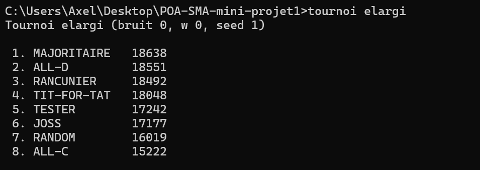
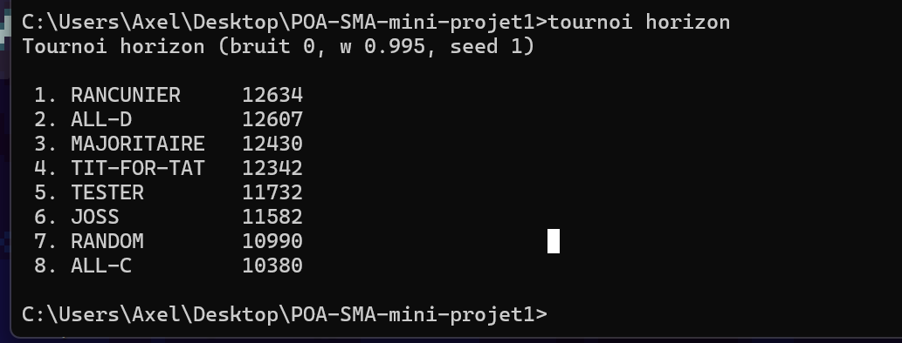

# Journal de bord – Tournoi du dilemme du prisonnier itéré

HAI716I – Projet 2 (partie 1)

## 1. Protocole

- **200 tours, 5 parties par paire** : c'est le format du tournoi d'Axelrod présenté en cours.
- **Gains** : ceux du cours (3/3 si les deux coopèrent, 5/0 si l'un trahit l'autre, 2/2 si les deux trahissent).
- **Chacun contre chacun**, mais pas contre soi-même, parce que le sujet dit « chaque stratégie affronte chaque autre ». À la fin, on additionne les points et le plus gros total gagne.
- **Graine 1** (on peut en mettre une autre avec `./tournoi base 7`) : comme ça, je retrouve exactement les mêmes résultats à chaque lancement.
- **Modifications retenues** : le bruit (5 % des coups inversés par erreur) et l'horizon inconnu (la partie continue avec une probabilité w = 0,995 après chaque tour, soit 200 tours en moyenne). Ce sont les plus simples à coder, et elles sont liées au cours : slide 72 pour le bruit, slides 61-62 pour l'horizon.
- **Horizon inconnu** : je tire la longueur des 5 parties une seule fois au début, et toutes les paires jouent les mêmes longueurs. Sinon, une stratégie pourrait gagner juste parce qu'elle est tombée sur des parties plus longues.

## 2. Stratégies

### Celles du cours, plus ALL-C

| Stratégie | Règle | Origine | Bien contre | Mal contre (pourquoi) |
|---|---|---|---|---|
| ALL-D | trahit toujours | récurrence à rebours (slide 61) | ALL-C, RANDOM | ceux qui ripostent (2 points par tour seulement) |
| ALL-C (ajoutée) | coopère toujours, l'inverse d'ALL-D | la stratégie naïve | les gentilles | tout le monde l'exploite (0 point contre ALL-D) |
| RANDOM | C ou D au hasard | témoin d'Axelrod | ALL-C | ALL-D, RANCUNIER (punie tout le temps) |
| TIT-FOR-TAT | C au début, puis copie l'autre | Rapoport, gagnant en 1980 | les gentilles | ALL-D, JOSS (échos de punitions) |
| TESTER | D au début ; si l'autre a déjà trahi, copie-le, sinon C, C, D | tournoi d'Axelrod | ALL-C (ne riposte jamais) | TIT-FOR-TAT (alternance D/C) |
| JOSS | TIT-FOR-TAT qui trahit 1 fois sur 10 | Johann Joss, Axelrod | ALL-C, MAJORITAIRE | TIT-FOR-TAT, RANCUNIER (punissent ses trahisons) |

### Mes nouvelles stratégies

**RANCUNIER** coopère jusqu'à la première trahison de l'adversaire, puis trahit jusqu'à la fin de la partie. C'est le « Grim Trigger », une stratégie classique des jeux répétés. Avec les gentilles, elle coopère tout le long. Contre RANDOM, elle marche très bien : dès que RANDOM trahit une fois, elle trahit pour toujours et gagne 5 points à chaque fois que RANDOM coopère. Par contre, elle est nulle contre TESTER : TESTER trahit au premier tour, donc RANCUNIER ne coopère plus jamais avec lui. En gros, elle punit très fort mais ne pardonne jamais.

**MAJORITAIRE** regarde tous les coups de l'adversaire depuis le début et joue celui qu'il a joué le plus souvent (C au premier tour et en cas d'égalité). C'est une stratégie connue des tournois du dilemme itéré (« soft majority »). Je l'ai choisie parce que c'est la seule qui regarde toute la partie, et pas seulement le dernier coup. Avec les gentilles, elle coopère tout le long. Contre JOSS, elle s'en sort mieux que TIT-FOR-TAT, parce qu'un D isolé ne change pas la majorité, donc elle ne part pas dans des échos de punitions. Par contre, elle est lente à réagir : si l'adversaire se met à trahir, elle continue de coopérer un moment avant de changer.

## 3. Étape 1 : tournoi de base

**TIT-FOR-TAT ne gagne pas, c'est ALL-D**, et TIT-FOR-TAT finit juste derrière.

La grosse différence vient de RANDOM. ALL-D gagne 5 points quand RANDOM coopère et 2 quand elle trahit, donc environ 3500 points sur le match. TIT-FOR-TAT, lui, recopie les trahisons de RANDOM au lieu de profiter de ses coopérations, et ne fait qu'environ 2500 points. TIT-FOR-TAT rattrape un peu contre TESTER (2500 contre 2000 pour ALL-D), mais ça ne suffit pas.

Pourquoi c'est différent de 1980 :
- ici, TIT-FOR-TAT est la seule stratégie gentille (qui ne trahit jamais en premier), donc elle n'a personne avec qui coopérer. En 1980, il y avait beaucoup de stratégies gentilles, et c'est justement dans ce cas que TIT-FOR-TAT gagne (slide 69) ;
- chez Axelrod, chaque stratégie jouait aussi contre son jumeau. TIT-FOR-TAT contre TIT-FOR-TAT fait 3000 points, ALL-D contre ALL-D seulement 2000. Moi, je n'ai pas mis ce match ;
- dans le cours, la punition D/D vaut 2, alors qu'elle valait 1 chez Axelrod. Quand tout le monde trahit, on gagne plus, et ça aide ALL-D.

## 4. Étape 2 : avec les nouvelles stratégies

- **MAJORITAIRE gagne de justesse** devant ALL-D et RANCUNIER : il y a moins de 150 points d'écart entre les trois, donc c'est presque une égalité.
- **ALL-D reste en haut seulement grâce à ALL-C**, à qui il prend 5000 points (le maximum). Sans ce match, il serait loin derrière, parce que contre les autres stratégies gentilles il ne fait qu'environ 2000 points.
- **RANCUNIER et MAJORITAIRE** marchent bien parce qu'elles coopèrent à fond avec les gentilles tout en sachant se défendre. RANCUNIER gagne en plus beaucoup de points contre RANDOM.
- **TIT-FOR-TAT passe 4e** : elle perd des points contre JOSS à cause des échos de punitions, alors que MAJORITAIRE laisse passer un D isolé.
- **ALL-C finit dernière**, puisque tout le monde peut l'exploiter.

## 5. Étape 3 : bruit et horizon inconnu

### Prédictions

**Bruit 5 % :**
- TIT-FOR-TAT va baisser : une erreur déclenche une suite de punitions en écho (slide 72) avec JOSS, TESTER, RANCUNIER et MAJORITAIRE.
- RANCUNIER : à la première erreur d'un partenaire gentil, il trahit pour toujours. Il perd la coopération, mais il devient une sorte d'ALL-D qui exploite ALL-C et RANDOM. Je pense qu'il reste dans les trois premiers.
- MAJORITAIRE devrait monter, peut-être à la première place : un D isolé ne change pas la majorité, donc une erreur ne casse pas la coopération.
- ALL-D devrait rester en haut : quand les autres se mettent à trahir à cause des erreurs, toujours trahir n'est pas une mauvaise idée.
- ALL-C va rester dernière, et même perdre plus : quand le bruit transforme un de ses C en D, RANCUNIER la punit jusqu'à la fin.

**Horizon inconnu (w = 0,995) :**
- Aucune de mes stratégies ne compte les tours ni ne sait quand la partie finit, donc le classement devrait être presque le même qu'à l'étape 2.
- Les scores totaux vont changer, parce que les parties n'ont plus 200 tours pile.
- Les trois premiers sont très proches, donc leur ordre peut changer.

### Bruit

- **Juste** : TIT-FOR-TAT baisse, RANCUNIER finit 1er, ALL-D reste 2e, et ALL-C reste dernière en perdant encore plus de points.
- **Faux** : MAJORITAIRE passe de la 1re à la 4e place.
- **Pas prévu** : JOSS monte à la 3e place.

Pour MAJORITAIRE, je n'avais pensé qu'aux erreurs de l'adversaire, qui ne changent pas la majorité. Mais quand c'est elle qui fait une erreur (son C devient D), RANCUNIER la punit jusqu'à la fin. Et comme MAJORITAIRE réagit lentement, elle continue de coopérer tant que RANCUNIER a plus de C que de D, donc elle se fait exploiter pendant longtemps. Sa patience, qui l'aidait sans bruit, devient un défaut.

RANCUNIER, lui, devient une sorte d'ALL-D dès la première erreur. Avec du bruit, presque tout le monde finit par faire une erreur contre lui, donc il trahit souvent, et trahir souvent marche bien quand la coopération casse partout. C'est aussi pour ça qu'ALL-D reste juste derrière.

Pour JOSS, je pense que le bruit casse parfois ses blocages en D contre D avec TIT-FOR-TAT ou TESTER (un D peut redevenir C par erreur). TIT-FOR-TAT recule à cause des échos de punitions (slide 72), et ALL-C perd encore plus parce que RANCUNIER la punit pour toujours dès sa première erreur.

### Horizon inconnu

- **Juste** : à partir de la 4e place, le classement est exactement le même qu'à l'étape 2. Seuls les trois premiers, qui étaient déjà presque à égalité, changent de place.
- **Juste aussi** : les scores changent. Ils sont plus bas parce que les parties tirées sont plus courtes au total.

C'est logique, parce qu'aucune de mes stratégies ne compte les tours : ne pas savoir quand la partie s'arrête ne change rien à leur façon de jouer. La récurrence à rebours de la slide 61 concerne un joueur qui sait quand c'est le dernier tour et qui en profite pour trahir. Ici, personne ne fait ça, donc l'horizon inconnu change seulement la longueur des parties. Pour voir un vrai effet, il faudrait une stratégie qui trahit au 200e tour.

## 6. Impasses

- **Première version trop compliquée** (classes, pointeurs intelligents, quatre modifications) : je l'ai refaite avec des fonctions simples, des boucles et un tri à bulles.
- **ALL-C trop proche d'ALL-D** : au début, mes nouvelles stratégies étaient ALL-C et RANCUNIER. ALL-C étant juste l'inverse d'ALL-D, j'ai ajouté MAJORITAIRE.
- **`rand()` différent entre Mac et PC** : avec la même graine, j'ai eu des scores un peu différents, donc j'ai refait les captures sur le PC.
- **Pas de compilateur sur le PC** : j'ai installé WinLibs (GCC pour Windows) et ajouté son dossier au PATH. `make clean` ne marche pas sous Windows (pas de `rm`), donc j'utilise `del tournoi.exe`.
- **Horizon inconnu** : au début, chaque paire tirait ses propres longueurs de parties, ce qui pouvait fausser le classement. Je les tire maintenant une seule fois pour tout le tournoi.
- **`git init` avec l'URL** : ça a créé un dossier `https:` dans le projet. Je l'ai supprimé, puis j'ai fait `git remote add origin`.

## 7. Séances

- **13 novembre** : lecture du sujet, première version trop compliquée, puis version simple avec toutes les stratégies. Premier push.
- **14 novembre** : code simplifié, README, journal et prédictions de l'étape 3. Installation du compilateur sur le PC, lancement des tournois, captures et résultats de l'étape 3.
- **15 novembre** : vérification du code.
