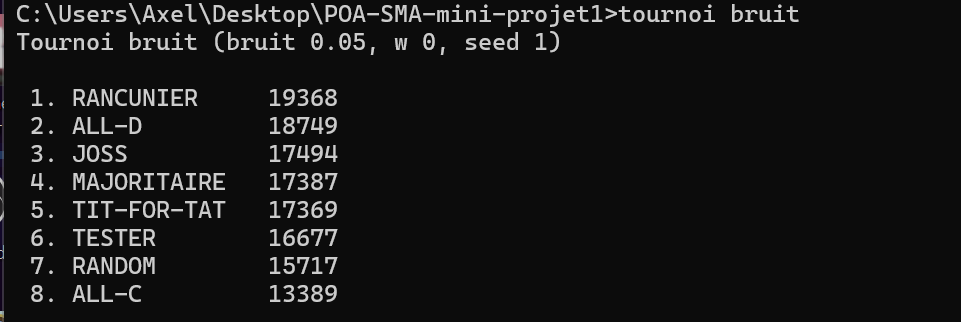

# Journal de bord : tournoi du dilemme du prisonnier itéré

HAI716I, projet 2 (partie 1), travail individuel.

## 1. Protocole

| Paramètre | Valeur | Pourquoi |
|---|---|---|
| Langage | C++17 | |
| Gains | 3/3, 0/5, 5/0, 2/2 | matrice du cours, imposée par le sujet |
| Tours par partie | 200 | format d'Axelrod |
| Parties par paire | 5 | format d'Axelrod |
| Qui affronte qui | chaque stratégie contre chaque autre, pas contre elle-même | |
| Graine aléatoire | 42 | |
| Bruit | 5 % | |
| Horizon inconnu | w = 0,995 (200 tours en moyenne) | |

*À remplir : la colonne « Pourquoi » pour les lignes vides (une phrase chacune).*

## 2. Stratégies

*Pour chaque stratégie : sa règle, d'où elle vient, contre qui elle devrait bien ou mal jouer, et pourquoi. La règle et l'origine sont déjà remplies ; à toi d'écrire le reste.*

### ALL-D
- **Règle :** joue toujours D.
- **Origine :** la stratégie « rationnelle » de la récurrence à rebours (cours, slide 61).
- **Bien contre :**
- **Mal contre :**
- **Pourquoi :**

### RANDOM
- **Règle :** C ou D au hasard, une chance sur deux.
- **Origine :** le témoin du tournoi d'Axelrod.
- **Bien contre :**
- **Mal contre :**
- **Pourquoi :**

### TIT-FOR-TAT
- **Règle :** C au premier tour, puis recopie le dernier coup de l'adversaire.
- **Origine :** Anatol Rapoport, gagnant du tournoi d'Axelrod de 1980.
- **Bien contre :**
- **Mal contre :**
- **Pourquoi :**

### TESTER
- **Règle :** D au premier tour ; si l'adversaire a déjà joué D, fait comme TIT-FOR-TAT ; sinon répète C, C, D.
- **Origine :** stratégie soumise au tournoi d'Axelrod, présentée dans le cours.
- **Choix d'interprétation :** la diapositive dit « si l'adversaire riposte » sans dire quand ; j'ai retenu « si l'adversaire a joué D au moins une fois ».
- **Bien contre :**
- **Mal contre :**
- **Pourquoi :**

### JOSS
- **Règle :** comme TIT-FOR-TAT, mais un C sur dix est remplacé par D.
- **Origine :** Johann Joss, tournoi d'Axelrod.
- **Bien contre :**
- **Mal contre :**
- **Pourquoi :**

### ALL-C (nouvelle)
- **Règle :** joue toujours C.
- **Origine :** la stratégie « naïve », qui coopère sans condition.
- **Bien contre :**
- **Mal contre :**
- **Pourquoi :**

### RANCUNIER (nouvelle)
- **Règle :** C tant que l'adversaire n'a jamais joué D, puis D pour toujours.
- **Origine :** Grim Trigger, stratégie classique des jeux répétés.
- **Bien contre :**
- **Mal contre :**
- **Pourquoi :**

## 3. Étape 1 : tournoi de base

Commande : `./tournoi base`

| Rang | Stratégie | Score |
|---|---|---|
| 1 | | |
| 2 | | |
| 3 | | |
| 4 | | |
| 5 | | |

**TIT-FOR-TAT gagne-t-il ?**

*À remplir. Si non, pourquoi le résultat diffère de 1980 ? Pistes : combien de stratégies « gentilles » (qui ne trahissent jamais en premier) y a-t-il ici, et combien y en avait-il en 1980 ? Que gagne ALL-D contre RANDOM, et TIT-FOR-TAT contre RANDOM ? Voir la slide 69.*

## 4. Étape 2 : nouvelles stratégies

Commande : `./tournoi elargi`

| Rang | Stratégie | Score | Rang à l'étape 1 |
|---|---|---|---|
| 1 | | | |
| 2 | | | |
| 3 | | | |
| 4 | | | |
| 5 | | | |
| 6 | | | |
| 7 | | | |

**Comparaison avec l'étape 1 :**

*À remplir. Qu'est-ce qui change dans le classement ? Qui profite d'ALL-C, et pourquoi ? Où se place RANCUNIER par rapport à TIT-FOR-TAT ?*

## 5. Étape 3 : modifications du tournoi

### Choix des modifications

- **Bruit :** *à justifier (piste : slide 72, une erreur entre deux TIT-FOR-TAT).*
- **Horizon inconnu :** *à justifier (pistes : slides 61 et 62, la récurrence à rebours et l'ombre du futur).*

### Prédictions (à écrire AVANT de lancer `bruit` et `horizon`)

*Écris ce que tu penses qu'il va se passer, puis fais un commit avant de lancer les tournois : l'historique git prouvera que la prédiction était écrite avant.*

- **Bruit 5 % :**
- **Horizon inconnu :**

### Résultats : bruit

Commande : `./tournoi bruit`

| Rang | Stratégie | Score | Rang sans bruit (étape 2) |
|---|---|---|---|
| 1 | | | |
| 2 | | | |
| 3 | | | |
| 4 | | | |
| 5 | | | |
| 6 | | | |
| 7 | | | |

**Prédiction contre résultat :**

*À remplir : ce qui était juste, ce qui était faux, et l'explication de l'écart.*

### Résultats : horizon inconnu

Commande : `./tournoi horizon`

| Rang | Stratégie | Score | Rang avec horizon fixe (étape 2) |
|---|---|---|---|
| 1 | | | |
| 2 | | | |
| 3 | | | |
| 4 | | | |
| 5 | | | |
| 6 | | | |
| 7 | | | |

**Prédiction contre résultat :**

*À remplir : ce qui était juste, ce qui était faux, et l'explication de l'écart.*

## 6. Impasses

*Ce qui n'a pas marché et ce que tu as changé (erreur de compilation, résultat bizarre, choix revu…). Les impasses expliquées ne font pas perdre de points.*

## 7. Séances

### Vendredi 13 novembre
- Mise en place du dépôt et du squelette du code.
